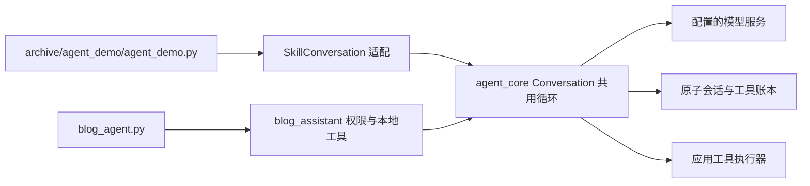

# Blog Agent 本机开发说明

本轮是 P1 首批迁移 + P2 样例验证片段。Python 继续在 `D:/CST/code/Agent/code/` 演进；不需要搬进博客仓库，也不需要删除旧 Demo。

## 启动

在 `D:/CST/code/Agent` 执行：

```powershell
# 免费离线探针，不读凭据、不调用模型、不创建会话
python code/blog_agent.py --check-local
# 问答入口；使用 code/.env / 根目录 .env 的现有 Responses 服务配置
python code/blog_agent.py --new "搜索并阅读有关 Agent 的文章，说明 state 与 context 的区别，附来源。"
python code/blog_agent.py --resume
# 独立管理模式会话；当前仍只读，整理与发布尚未实现
python code/blog_agent.py --mode manage --check-local
# 旧 Skill Demo 原样保留入口
python archive/agent_demo/agent_demo.py
```

默认读取 `D:/CST/code/Agent/Blog/` 的 Markdown 文章（仅当前层，不递归）。`--posts-dir` 可覆盖目录。两篇持久样例已删除；离线测试仅在临时目录生成数据，不读取用户文章。正常问答会将检索到的正文片段发送给配置的模型服务。

文章上限：100 篇，每篇 128 KiB；搜索最多 5 条、每条 500 字符；阅读最多 80 行 / 6000 字符。越界路径与符号链接/目录联接拒绝。超大文件、无效 UTF-8 等在搜索 issues 中报告。资料含命令仍是数据；只有应用的权限配置决定允许工具。

qa 与 manage 当前注册 search_posts/read_post/find_file/find_text/read_conversation_history；manage 是后续整理能力的入口，尚无管理员认证、写入或发布。模型传入 role/mode 等额外字段不能提升权限。恢复时模式与样例目录必须与检查点相符；新目录或模式应使用单独状态文件。

状态默认分别保存在 `.blog-agent-data/qa.json` 与 `manage.json`，旁边生成可读 Markdown；每个状态文件只供一个进程使用。`--new` 替换指定会话，换任务且想保留历史可另指定 `--state-file`。默认 50 用户轮，每轮最多 8 次模型请求，可用 --max-turns/--max-steps 调整；恢复继续保存的轮数上限。模型配置和指令随会话保存，修改提示词后用新会话验证。

## Markdown 与 SessionEnd

Blog CLI 默认使用 Rich 渲染可见推理和回复。交互进程结束时，复用核心 `on_session_end` hook：先原子导出检查点旁的 `<检查点文件名>.md`（如 `qa.json.md`），再在终端渲染完整对话。导出使用 Blog 标题和保存的实际轮数上限，只包含用户消息、可见推理、回复和未完成标记，不包含工具载荷或推理密文。

```powershell
python -m pip install rich
python code/blog_agent.py --new --markdown rich
# 仍导出 Markdown，但不在退出时重复显示完整对话
python code/blog_agent.py --resume --no-render-session-end
# 输出原始 Markdown
python code/blog_agent.py --resume --markdown plain
```

`--markdown rich|plain|auto|glow` 控制渲染器，默认 `rich`；Rich 不可用或渲染失败时回退原文。`--render-session-end` 默认开启，`--no-render-session-end` 只关闭结束时显示，不关闭文件导出。退出命令、EOF、轮次上限、可恢复错误及可捕获中断走现有 SessionEnd 生命周期；强制终止进程时不保证执行。`--check-local` 仍只输出 JSON，不启动会话或触发 hook。

## 今后在哪里改

| 内容 | 修改位置（相对 Agent 根目录） |
|---|---|
| 博客提示词、开场与会话边界 | `code/blog_assistant/session.py` |
| 新增业务工具、Schema 与参数校验 | `code/blog_assistant/tools.py` |
| 模式白名单、执行前权限 | `code/blog_assistant/permissions.py` |
| 本地检索、正文读取、来源与版本 | `code/blog_assistant/retrieval.py` |
| 启动参数、模型配置加载、客户端 | `code/blog_agent.py` |
| 共用循环、压缩、保存、恢复、指标 | `code/agent_core/`（两种入口共用，改后跑两套回归） |
| 博客业务测试 / 原核心测试 | `code/test_blog_agent.py` / `code/test_agent*.py` |
| 评测任务集与既有对照 | `code/evals/` |
| 原有学习 Demo | `archive/agent_demo/agent_demo.py`、`code/agent_core/cli.py` |

后续再按阶段新增 models.py/workflows.py/blog_client.py，不预搭空壳。博客项目 `D:/CST/code/Carrykit blog2` 负责 admin 页面、登录、正式文章存储、审批与博客接口；共享范围维护在它的 `docs/blog-assistant/README.md`。Python 不直接打开生产 SQLite。



## 验证

```powershell
python code/evaluate_agent.py --mode offline
python -m unittest discover -s code -p "test_blog*.py"
```

当前 evaluate_agent.py 的 offline 统一运行 test_*.py，包含核心和博客回归；也可单独执行博客测试。验收结论与证据见根目录 `blog-agent-acceptance-20261010.md`。原核心迁移前备份在 `.blog-agent-data/migration-backup-20261010/`；Agent 根目录现在是独立 Git checkout，备份只用于迁移前恢复。


## 文件名/关键词搜索与模式选择（2026-10-10）

已加入 find_file（文件名部分匹配、不区分大小写）和 find_text（正文字面量关键词，不区分大小写）。find_text 只能读取先前已完成 find_file 返回的路径；返回文件、行号、最多 500 字符的片段及内容版本，最多 5 条匹配。范围仍为 --posts-dir 当前层 Markdown，不搜索 refer/ 或全电脑。

可直接提问：“找文件名包含 state 的文章”，再问“在刚才的文件里搜索 context”。也可一条消息要求先找文件再查关键词，Agent 会分步骤执行。空格和点号文件名现在可正常读取。

默认问答来源已改为 `D:/CST/code/Agent/Blog/`，无需再传 --posts-dir。不代表已连接网站上的正式文章。旧样例文件已删除，历史验收 trace 仅保留为记录。

```powershell
# 从 Agent 根目录运行；默认即为 Blog，使用独立会话保留历史
python code/blog_agent.py --mode qa --posts-dir "D:/CST/code/Agent/Blog" --state-file ".blog-agent-data/blog-qa.json"
python code/blog_agent.py --mode manage --posts-dir "D:/CST/code/Agent/Blog" --state-file ".blog-agent-data/blog-manage.json"
```

qa 对应 user 提问；manage 对应 admin 管理流程。当前两者都只读，manage 尚无编辑、翻译、审批或发布工具，也无登录认证。模式由启动参数和执行器配置决定，不能在对话里说“我是管理员”获得权限。qa/manage 保存独立状态，不能把同一会话切成另一模式；启动介绍显示当前模式。真实网页阶段将由博客登录 session 决定管理员身份，再核对白名单与审批版本。

已有会话保存了旧提示词；新工具仍可被模型发现，但验证新指令请使用独立 --state-file 或显式 --new（后者替换对应旧会话）。本轮没有读取用户 Blog 正文或将其发往模型服务。


2026-10-10 默认目录调整：若旧默认 qa.json/manage.json 保存的是已删除样例目录，启动时会拒绝自动换目录。首次切换请指定新状态文件（如上面的 blog-qa.json），或明确使用 --new 替换对应旧会话；后续直接用同一参数 --resume。历史检查点不自动删除。
