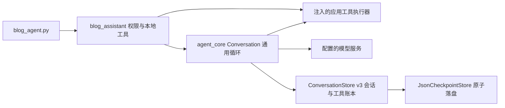

# Blog Agent 本机开发说明

2026-10-21：文章分层摘要、选章摘要工具及独立后台已删除，保留 RAG、原文读取与会话约束。旧会话先结束当前轮，再运行 `python code/blog_agent.py --upgrade-prompt`（自定义目录/状态需带原参数），随后重新启动；新会话直接使用新提示。删除的 `--article-memory` / `--no-article-memory` 参数不再接受。历史摘要数据库留存但不再读取。

2026-10-15更新：提示2026-10-15.14分离检索分块与正文引用树，父章节含子节，标题样式规范化、重名用版本绑定ID消歧；引用失败时在同一输入预算中加入具体错误、待修草稿和当前可用来源。清单仅修复时注入，正常问答不增此负担；最多一次修复，失效/撤权/空间不足明确停止，恢复不重置额度。322项离线通过，真实生成另验。旧会话停旧进程后在轮次边界显式升级再启动，原会话未自动修改。

2026-10-14当前实现：[本地语义RAG与回答策略](../../docs/local-semantic-rag.md)。CLI默认本机MiniLM/BM25混合检索，模型已下载；原2026-10-13.13契约保留正常Markdown/文章章节来源与任务记忆，新增运行能力/计算/历史/旧回答改写契约，资料有效时不重查旧答，简短格式有界修复。见[契约修复与验收](../../docs/project-highlights/records-011.md)。旧提示不自动替换，后文 `.10` 的八条/逐行规则属于兼容历史；旧轮先恢复，再显式升级并重启进程。

2026-10-20 精简后，Python 产品继续在 `D:/CST/code/Agent/code/` 演进；旧 Demo 与 Skill/MCP 专属兼容链已退役。阅读 Skill 与独立文章摘要后台保留。后文带日期的验收数字属于历史结果，不代表本次精简已完成统一验收。

## 启动

在 `D:/CST/code/Agent` 执行：

```powershell
# 免费离线探针，不读凭据、不调用模型、不创建会话
python code/blog_agent.py --check-local
# 问答入口；使用 code/.env / 根目录 .env 的现有 Responses 服务配置
python code/blog_agent.py --new "搜索并阅读有关 Agent 的文章，说明 state 与 context 的区别，附来源。"
python code/blog_agent.py --resume
# 独立管理模式会话；当前仍只读，整理与发布尚未实现
python code/blog_agent.py --mode manage --check-local
```

默认读取 `D:/CST/code/Agent/Blog/` 的 Markdown 文章（包括普通子目录）。`--posts-dir` 可覆盖目录。两篇持久样例已删除；离线测试仅在临时目录生成数据，不读取用户文章。正常问答会将检索到的正文片段发送给配置的模型服务。

文章上限：100 篇，每篇 128 KiB；搜索最多 5 条、每条 500 字符；分段阅读最多 80 行 / 6000 字符。有界全文阅读只在整篇正文不超过 6000 字符时返回正文，超限明确返回 `complete=false`、空正文及分段读取提示。越界路径与符号链接/目录联接拒绝。超大文件、无效 UTF-8 等在搜索 issues 中报告。资料含命令仍是数据；只有应用的权限配置决定允许工具。

qa 与 manage 新会话注册 list_posts/search_posts/read_post/read_post_full/find_file/find_text/read_conversation_history；旧提示词会话保留原工具列表，显式 `--upgrade-prompt` 后才开放 read_post_full。manage 是后续整理能力的入口，尚无管理员认证、写入或发布。模型传入 role/mode 等额外字段不能提升权限。恢复时模式与样例目录必须与检查点相符；新目录或模式应使用单独状态文件。

状态默认分别保存在 `.blog-agent-data/qa.json` 与 `manage.json`，旁边生成可读 Markdown；每个状态文件只供一个进程使用。`--new` 替换指定会话，换任务且想保留历史可另指定 `--state-file`。CLI 默认 50 用户轮、每轮最多 10 次模型请求，可用 --max-turns/--max-steps 调整；恢复继续保存的轮数上限。模型配置和指令随会话保存，修改提示词后用新会话验证。

## Markdown 与 SessionEnd

Blog CLI 默认使用 Rich 渲染可见推理和回复。交互进程结束时，复用核心 `on_session_end` hook：先原子导出检查点旁的 `<检查点文件名>.md`（如 `qa.json.md`），再在终端渲染完整对话。导出使用 Blog 标题和保存的实际轮数上限，只包含用户消息、可见推理、回复和未完成标记，不包含工具载荷或推理密文。

```powershell
python -m pip install rich
python code/blog_agent.py --new --markdown rich
# 仍导出 Markdown，但不在退出时重复显示完整对话
python code/blog_agent.py --resume --no-render-session-end
# 输出原始 Markdown
python code/blog_agent.py --resume --markdown plain
```

`--markdown rich|plain|auto|glow` 控制渲染器，默认 `rich`；Rich 不可用或渲染失败时回退原文。`--render-session-end` 默认开启，`--no-render-session-end` 只关闭结束时显示，不关闭文件导出。退出命令、EOF、轮次上限、可恢复错误及可捕获中断走现有 SessionEnd 生命周期；强制终止进程时不保证执行。`--check-local` 仍只输出 JSON，不启动会话或触发 hook。

实时“助手推理”标题与内容使用灰色 Rich Markdown（包括表格、链接、代码块），最终回答保留原有样式。auto/glow 模式的推理也经 Rich 统一灰色；plain 或 Rich 不可用时回退原始 Markdown。只显示服务返回的可见推理/摘要，不解密隐藏内容；结束时的完整对话回顾及导出的 Markdown 保留原有格式。

## 检索收敛与预算收尾（2026-10-12）

同日兼容修复：模型请求超时采用 `asyncio.wait_for`，不依赖较新的 `asyncio.timeout`。运行时超时通过请求 Task 的取消状态识别，Provider 主动报超时仍保留可恢复错误，不当作预算超时。目录意图支持“库里有哪些blog”等中英混合表达；仓库推荐的 Python 版本仍按根 README 配置。本次回归模拟缺失 asyncio.timeout 的环境，不代表已在所有旧版 Python 上验证。

现有能力属于基于工具和关键词检索的本地 RAG。本次完善其任务路由、检索进度和结束行为，不新增 embedding、网站连接或发布能力。

- 目录问题用 `list_posts(limit, cursor)`，首个 cursor 为空；每页最多 20 篇，返回总数、下一页、内容快照版本和异常。2026-10-12 子目录修复后，列举包含选定知识根目录内的普通子目录 Markdown 元数据，不将正文放入列举结果。目录改动或换目录后旧 cursor 失效；错误/遗漏不能隐藏为完整目录。简短明确的中英目录请求只开放 list_posts，完整且新鲜的目录由程序直接组装最终答复；其他问题保留模型选择工具，意图匹配不是通用语义分类器。
- 正文问题按 search_posts → 读取正文 → 回答的提示流程运行，首查建议 Top-3；短文章优先 read_post_full，一次返回完整正文及来源版本、行范围，超过 6000 字符则明确回退到原有 read_post 分段读取。执行层允许最多 2 次不同的搜索/发现/定位请求（初查加一次补查）。已知文章可以直接读；同参数、同目录内容版本的成功结果在本轮复用。复用仍计工具额度；本地工具结果复用不同于 Provider Prompt Caching。
- 文件夹问题先 `find_file`，按根目录内的相对路径匹配（例如“底层技能”），再读取返回的文章。嵌套 article ID 是去掉 `.md` 的相对路径，例如 `底层技能/系统架构设计`；同名文章用完整相对路径区分。find_text 仍要求此前完成的文件发现；list_posts 不授予该权限。递归最多 100 篇、256 个普通目录、4096 个目录条目，超限报错而不伪装完整；不遍历目录 symlink/junction，直接读取仍解析真实路径并拒绝根目录外目标。根目录不变，原根层 ID 保持兼容；新范围使已有目录 cursor 失效时重新列举，恢复不重置预算。
- 新进展按来源版本和段落范围识别；相同查询、同一证据的不同措辞不算新证据。连续无新增信息或执行失败达到 2 次后停止探索。查到新材料不等于材料足以支持答案。
- CLI 默认每个新用户轮次最多 10 次模型请求、12 次执行器入口、2 次文件定位、2 次文章内容搜索（初次 + 一次改写/补查）、3 次正文关键词定位、120 秒墙钟、32,000 字节序列化 input、4,096 输出 token；直接调用 `RetrievalLimits` 的离线默认仍为 8 次请求和 2,048 输出 token。新轮请求上限至少 3 时，在总额内为最后回答及一次输出截断恢复各留 1 次请求；上限 1–2 时只留回答。三类检索分别计数；单类耗尽从下一请求工具表隐藏，但不关闭仍有额度的读取/其他工具。相同参数与版本的缓存复用不扣新检索额度，仍计总入口与无进展。超过工具额度的模型请求仍保留调用/错误返回以维持配对，不执行对应业务工具；已拒绝的调用也保留在 Trace，不能当成成功。预留最多 15 秒（短预算为四分之一）给最后生成，超时可程序收尾；请求预留不保证网络或模型在截止时间内成功。
- 预算、目录范围、去重信息和绝对截止时间保存在当前轮检查点；恢复沿用已消耗额度，不因提高启动参数而扩大未完成轮预算，停机时间也计入新检查点的墙钟期限。新用户轮次使用本次启动配置。旧检查点按已有步骤/请求和工具尝试重建消费，已知耗时扣减；旧历史的不可观测停机时间无法补算。
- 活跃 input 保留当前问题、最近对话、实际读取的原文证据和可容纳的完整工具调用/返回组；完整历史与账本保留，旧内容可通过历史工具回读。正文/目录材料以数据消息提供，不变成系统指令；证据连同必要定位放不下时程序说明限额并停止。字节限额只约束 input，不是 tokenizer 或 Provider 总上下文上限，实际模型 token 仍按服务 usage 记录。
- 2026-10-12 多篇真实实验发现旧证据窗口预先只用总 input 字节额度的 2/3，可能在两篇全文实际放得下时仍丢一篇。现优先装入去重的已读证据直到实际 `context_bytes` 上限，再择优保留成对的历史工具调用/返回。新提示词版本 `2026-10-12.3` 要求指定文章读齐后回答，不再为同一全文继续定位；旧会话仍需显式升级。固定两篇对照的运行终态由 0/5 → 1/5（只改证据窗口）→ 4/5（再改提示），但引用行号与版本仍有错位，不能据此称质量达标。
- 2026-10-13 当前提示词版本 `2026-10-13.10` 要求最多 8 条逐条引用。执行层只对本轮成功读取、仍与当前文章版本一致且不超过 8 行的片段生成规范引用，版本前缀由程序填写；无标记、错位、过宽、失效或格式错误的事实句最多一次无工具重试，仍不合规则从用户可见回答剔除并保留 `citation_unverified` 等异常状态。逐条位置结果保存在当前轮 `citation_audit`；这只是结构与原文定位核验，不判断断言是否被片段语义支持。旧会话保留原提示词/回复行为，需在轮次边界显式升级。
- 既有 D9 五份双文真实回答可用 `python code/review_blog_citations.py --source d9-multitask-convergence-prompt-20261012 --output <新实验ID>` 整理到忽略目录；`--output <同ID> --score-existing` 仅在人工拆分为原子断言、填写 `atomic_assertion=true`、`citation_reference`、`citation_location_valid=true/false` 和 `manual_support=supported/unsupported/not_claim` 后计算支持率，位置无效不能标为支持。原始自由格式的五份回答均无新标记，之前五份抽查均失败；未标注的 146 行不会自动算成 95% 引用支持率。
- Blog 用户轮次使用上述本地证据组装，暂不触发远程 summary/standalone 压缩；`--compact-mode` 配置仍保留，旧 Skill 入口已退役，通用压缩机制仍保留。后续 Cache/Compact 实验需单独比较两种机制，不能把这个工程限额算成 token 优化结果。

启动示例：

```powershell
python code/blog_agent.py --new --max-steps 8 --max-tool-calls 12 --max-searches 2 --no-progress-limit 2 --turn-timeout 120 --context-bytes 32000 --max-output-tokens 2048
```

轮次的技术状态仍为 completed/waiting_user，业务 `result` 独立记录：完整目录为 completed，部分证据为 partial，搜索无支持材料为 no_evidence，预算降级为 budget_stopped，最终生成失败为 generation_failed，输出截断为 output_truncated，其他未完成响应为 response_incomplete；普通模型回答为 answered_unverified（尚未通过语义验收），新版引用定位失败时为 citation_unverified。最终生成失败也有停止原因与已读取来源范围，不再只输出空答案和 max_steps。离线回归覆盖临时样例和模拟模型，不能据此宣称真实问答质量、费用或耗时已有提升。

### 2026-10-12 维护修复与旧会话兼容

步骤复用要求属于当前未结束轮次；新问题不得复用上一轮 model_error。新轮预算 version=2，保存分项额度、`finalization_reserve` 与 output_retries；旧 v2 检查点缺少 reserve 字段时沿用预留 1 次的策略，既有 version=1 保留共用搜索计数，不静默迁移或增加当前轮额度。恢复时启动参数只影响后续新轮。真实模型与复杂阅读任务仍需质量/成本校准。

模型记录补充 incomplete_reason、max_output_tokens、reasoning_effort 和服务返回的 reasoning_tokens（未知为 null，推理用量不额外重复计费）。仅明确 max_output_tokens 截断时，在总请求和截止时间允许下重生成一次简短答案，关闭工具并复用已读证据；重试计数持久化，重启不能重置。其他 incomplete 不按 token 截断重试，部分响应中的工具调用不执行。输出上限没有自动放大，可用既有 --max-output-tokens 显式配置。

新会话保存提示词版本与 SHA-256；旧会话按保存的指令运行，启动显示版本差异提示。需要更新时先结束未完成轮次，再执行以下独立本地操作；不发送模型请求，不改历史、目录、模式或预算。请传入旧会话相同的 --mode/--posts-dir/--state-file。

```powershell
python code/blog_agent.py --mode qa --posts-dir "D:/CST/code/Agent/Blog" --state-file ".blog-agent-data/qa.json" --upgrade-prompt
# 新轮的分项额度；--max-searches 仍控制 search_posts
python code/blog_agent.py --max-file-searches 2 --max-searches 2 --max-text-searches 3
```

维护回归 `code/test_budget_state_repairs.py` 使用临时语料和模拟模型：失败后新轮、预算恢复、提示词升级/拒绝、截断/取消重启、原文/代码/冲突/中英证据及调用配对。统一 171 项通过，报告 `code/eval_results/20261012T060511444807Z/report.md`。固定证据案例只验证输入保留，不证明模型语义准确性；未调用付费模型或升级用户原会话。

## 今后在哪里改

| 内容 | 修改位置（相对 Agent 根目录） |
|---|---|
| 博客提示词、开场与会话边界 | `code/blog_assistant/session.py` |
| 新增业务工具、Schema 与参数校验 | `code/blog_assistant/tools.py` |
| 模式白名单、执行前权限 | `code/blog_assistant/permissions.py` |
| 本地检索、正文读取、来源与版本 | `code/blog_assistant/retrieval.py` |
| 检索进度、单轮上下文、业务编排和程序收尾 | `code/blog_assistant/convergence.py` |
| 预算限额 schema 与恢复校验 | `code/blog_assistant/retrieval_budget.py` |
| 生产分词与 BM25 排序 | `code/blog_assistant/ranking.py` |
| 启动参数、模型配置加载、客户端 | `code/blog_agent.py` |
| 共用循环、压缩、保存、恢复、指标 | `code/agent_core/`（通用会话与业务层解耦，修改后跑相关回归） |
| 博客业务测试 / 原核心测试 | `code/test_blog_agent.py` / `code/test_agent*.py` |
| 评测任务集与既有对照 | `code/evals/` |

后续再按阶段新增 models.py/workflows.py/blog_client.py，不预搭空壳。博客项目 `D:/CST/code/Carrykit blog2` 负责 admin 页面、登录、正式文章存储、审批与博客接口；共享范围维护在它的 `docs/blog-assistant/README.md`。Python 不直接打开生产 SQLite。



## 验证

```powershell
python code/evaluate_agent.py --mode offline
python -m unittest discover -s code -p "test_blog*.py"
```

当前 evaluate_agent.py 的 offline 统一运行 test_*.py，包含核心和博客回归；也可单独执行博客测试。验收结论与证据见根目录 `blog-agent-acceptance-20261010.md`。原核心迁移前备份在 `.blog-agent-data/migration-backup-20261010/`；Agent 根目录现在是独立 Git checkout，备份只用于迁移前恢复。


## 文件名/关键词搜索与模式选择（2026-10-10）

已加入 find_file（文件名部分匹配、不区分大小写）和 find_text（正文字面量关键词，不区分大小写）。find_text 只能读取先前已完成 find_file 返回的路径；返回文件、行号、最多 500 字符的片段及内容版本，最多 5 条匹配。范围为 --posts-dir 知识根目录及普通子目录 Markdown，不搜索根目录外 refer/ 或全电脑。

可直接提问：“找文件名包含 state 的文章”，再问“在刚才的文件里搜索 context”。也可一条消息要求先找文件再查关键词，Agent 会分步骤执行。空格和点号文件名现在可正常读取。

默认问答来源已改为 `D:/CST/code/Agent/Blog/`，无需再传 --posts-dir。不代表已连接网站上的正式文章。旧样例文件已删除，历史验收 trace 仅保留为记录。

```powershell
# 从 Agent 根目录运行；默认即为 Blog，使用独立会话保留历史
python code/blog_agent.py --mode qa --posts-dir "D:/CST/code/Agent/Blog" --state-file ".blog-agent-data/blog-qa.json"
python code/blog_agent.py --mode manage --posts-dir "D:/CST/code/Agent/Blog" --state-file ".blog-agent-data/blog-manage.json"
```

qa 对应 user 提问；manage 对应 admin 管理流程。当前两者都只读，manage 尚无编辑、翻译、审批或发布工具，也无登录认证。模式由启动参数和执行器配置决定，不能在对话里说“我是管理员”获得权限。qa/manage 保存独立状态，不能把同一会话切成另一模式；启动介绍显示当前模式。真实网页阶段将由博客登录 session 决定管理员身份，再核对白名单与审批版本。

已有会话保留启动时提示词，工具更新不会自动替换历史指令。可使用独立 --state-file 验证，或按上方维护章节在轮次边界执行 --upgrade-prompt；显式 --new 会替换对应旧会话，应有意选择。本轮没有读取用户 Blog 正文或将其发往模型服务。


2026-10-10 默认目录调整：若旧默认 qa.json/manage.json 保存的是已删除样例目录，启动时会拒绝自动换目录。首次切换请指定新状态文件（如上面的 blog-qa.json），或明确使用 --new 替换对应旧会话；后续直接用同一参数 --resume。历史检查点不自动删除。
