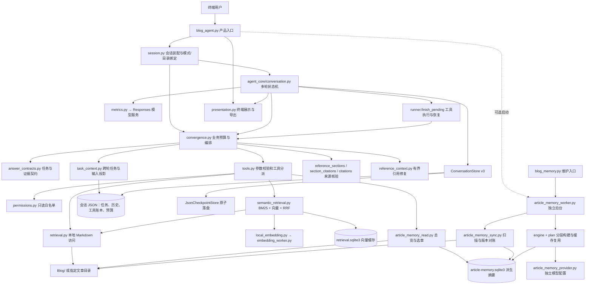

# Blog-Agent 当前架构与逐文件职责

核对日期：2026-10-20；增量同步旧链退役及生产依赖解耦。依据当前源码与原有逐文件梳理。本文描述现状，不代表规划功能已实现。

范围：当前 Git 管理的项目文件逐一列出；本次新增的本文也单独列出。用户文章、凭据、模型权重、会话、实验输出及本地学习目录不展开内容，仅说明目录职责。路径相对仓库根目录 `D:/CST/code/Agent`。

## 1. 总体结构

当前是 **Python 终端应用：单 Agent 主循环 + 受限本地文章工具 + 混合检索 + 可选独立文章摘要后台**。

- `code/blog_agent.py` 是产品入口；`blog_assistant` 决定博客业务行为；`agent_core` 提供共享循环、落盘、模型观测和展示。
- `qa`、`manage` 当前都只读。模式隔离不是登录认证；网站仍是独立仓库，尚无实际网站读取/审批/发布链路。
- 会话任务记忆、检索向量缓存、分层文章摘要是三套状态，生命周期和证据含义不同。
- 生产检索使用 `ranking.py` 的分词与 BM25；`retrieval_methods.py` 保留 EXP-2 离线分块、索引和对照。
- EXP-1/3 离线模拟与旧 Skill/MCP 专属运行链已退役；产品阅读 Skill 和摘要后台保留，产品尚未自动启动模型子代理。

图中数据库是默认本地存储，位于被忽略的 `.blog-agent-data/` 中；箭头表示调用或数据访问关系，并非部署网络拓扑。

## 2. 一次问答的执行顺序

1. `blog_agent.py` 读取参数、恢复或创建会话，组装模型、本地检索和可选文章记忆。
2. `session.create_conversation()` 将 `BlogStore`、`BlogTools`、`RetrievalPolicy` 接入共享 `Conversation`。
3. `answer_contracts` 判断需要文章、运行能力、计算、历史还是旧回答等证据；`task_context` 重验并投影当前任务的历史与来源。
4. `Conversation` 发起模型请求；工具调用交给 `runner.finish_pending()`，再经业务策略与工具层实施参数、权限及预算检查。
5. 搜索只提供候选；读取提供正文证据。混合检索用本地 embedding 与 BM25，必要时回退关键词。
6. 策略执行来源核验、必要的一次有界修复或程序收尾；目录、摘要等路径可确定性直接交付，不要求每条路径都调用生成模型。
7. 工具结果、请求用量和轮次状态落盘；展示层输出 Markdown，未完成轮次可恢复。

注意：Blog 业务策略激活时，由业务 `request_options()` 和任务投影控制输入；旧 Skill 助手入口已退役，通用压缩机制保留。完整历史与本轮模型输入窗口是不同概念。

## 3. 产品入口与维护/评测脚本

| 文件 | 作用 | 定位 |
| --- | --- | --- |
| `code/blog_agent.py` | 参数、会话、模型与检索装配；启动交互；本地检查；退出清理编码进程。 | 产品入口 |
| `code/setup_local_embedding.py` | 建立隔离编码环境、安装依赖、显式下载本地模型。 | 一次性安装 |
| `code/index_blog.py` | 预备或复用选定文章目录的语义索引，可执行检索探针。 | 本地索引维护 |
| `code/evaluate_agent.py` | 统一离线测试与只读 checkpoint 评估；旧 Demo live 已退役。 | 综合评测 |
| `code/evaluate_blog_retrieval.py` | EXP-0：合成文章、固定任务、模拟生成和 D9 回放。 | 离线实验 |
| `code/evaluate_blog_search.py` | EXP-2：检索基线与 BM25 等固定语料比较。 | 离线实验 |
| `code/evaluate_local_rag.py` | 合成冻结题集上的真实本地 embedding 检索验证，无付费生成。 | 本地检索评测 |
| `code/evaluate_blog_live.py` | 有费用上限与账本的真实博客问答试验，含 CostGuard。 | 真实模型实验 |
| `code/review_blog_citations.py` | 从已有回答制作人工断言审阅材料，计算已标注支持情况。 | 离线人工审阅辅助 |
| `code/judge_blog_citations.py` | 将原子断言与实际已读的引用原文交给 judge；默认 dry-run，execute 才请求模型。 | 可选付费语义审阅 |
| `code/grade_trace.py` | 读取 checkpoint，按规则评分轨迹，不执行工具或模型。 | 离线过程评分 |
| `code/compare_compression.py` | 对比两组用量或检查点，按给定价表计算费用并出图。 | 费用分析 |

## 4. 博客业务层：code/blog_assistant/

| 文件 | 作用 |
| --- | --- |
| `__init__.py` | 包标识与业务层说明。 |
| `session.py` | BlogStore、产品提示及提示版本、模式/目录绑定、旧状态校验、显式升级、会话装配和 trace sidecar。 |
| `convergence.py` | 核心业务编排：预算使用、路由、进展判断、工具选择、输入组装、结果复用、有界重试、引用审核和最终收尾。 |
| `retrieval_budget.py` | 检索限额 schema、持久预算恢复校验；由 convergence 编排使用。 |
| `ranking.py` | 生产分词与 BM25 排序，不依赖离线实验模块。 |
| `tools.py` | 工具声明和执行分派；强制参数类型/字段/范围校验；每次执行检查权限；对接文章、历史、检索与摘要。 |
| `permissions.py` | qa/manage 的应用工具白名单和执行前授权检查，当前均只读。 |
| `retrieval.py` | SamplePosts：目录安全、Markdown 扫描、快照与版本、分页目录、关键词搜索、文件/正文定位、全文与分段读取。 |
| `semantic_retrieval.py` | SQLite 增量向量缓存、本地编码、BM25/向量文章级 RRF 融合、版本复核、关键词回退和编码额度记录。 |
| `local_embedding.py` | 主进程编码适配器：JSON 行协议、隔离子进程、锁、超时、取消、重启和关闭。 |
| `embedding_worker.py` | 本地 FastEmbed 子进程，加载权重并输出向量；显式安装模式可下载模型。 |
| `sections.py` | Markdown 标题解析、检索范围和带精确坐标的分块；忽略围栏内假标题；join_lines 保留末行语义。 |
| `navigation.py` | 超限长文的有界目录与范围导航，不把导航当正文证据。 |
| `answer_contracts.py` | 任务/证据类型分类、受限 AST 四则计算、旧答定位、简短/一句话格式约束和恢复校验。 |
| `task_context.py` | 跨轮任务引用与继承、切题返回、来源权限/版本/原文重验、正文去重、约束与工具协议投影。 |
| `citations.py` | 从工具账本恢复实际已读行；兼容旧逐行引用审核；为当前章节核验提供正文可见性基础。 |
| `reference_sections.py` | 独立层级引用树、版本绑定章节 ID、父子范围、标题规范化、同名消歧与真实已读范围关联。 |
| `section_citations.py` | 文章/章节来源标记协议与版本兼容、来源审核、可读标签转换与重复来源处理。 |
| `reference_context.py` | 引用修复输入：具体错误、待修草稿和当前可见来源；遵守输入预算并校验恢复状态。 |
| `reading_skill.py` | 可选阅读技能快照、SHA-256 校验、请求注入及本地工具适配；不增加联网能力。 |
| `experiment.py` | EXP-0 合成语料、数据集契约、固定证据、模拟回答和评分/回放基础。 |
| `retrieval_methods.py` | EXP-2 分块、旧检索基线、离线索引与 RRF；复用生产 ranking，不被生产检索反向导入。 |
| `README.md` | 本机使用、开发位置、权限、预算、恢复与历史说明；部分后文为历史行为，当前以源码为准。 |

### 文章分层记忆已退役（2026-10-21）

保留RAG与原文证据、会话约束记忆；历史设计文档仅供追溯，不再提供后台或摘要工具。

## 5. 共享运行核心：code/agent_core/

| 文件 | 作用与使用范围 |
| --- | --- |
| `__init__.py` | 包标识。 |
| `conversation.py` | 共享多轮状态机、恢复、模型请求、工具登记、完成回答及终端 interactive_loop；由业务注入执行器。 |
| `runner.py` | finish_pending 执行注入的应用工具并持久化结果；旧 run_agent 已退役。 |
| `conversation_state.py` | ConversationStore：通用 v3 会话/轮次/工具/历史/上下文校验和迁移；BlogStore 的父类。 |
| `state.py` | JsonCheckpointStore 与公共 JSON 原子落盘：临时文件、刷盘和原子替换；旧 StateStore 已退役。 |
| `context.py` | 输入尺寸、历史分页、local/summary/standalone 压缩；Blog 业务主输入由策略投影控制。 |
| `reasoning.py` | 推理配置、SDK 推理提取、推理与历史索引关联及恢复。 |
| `metrics.py` | 模型请求每次尝试的 token、缓存、耗时、输入字节、用途和停止原因，缺值保持未知。 |
| `tracing.py` | 事件 schema、结构化轨迹、工具结果哈希、恢复/中断事件。 |
| `errors.py` | 权限拒绝、持久化、IO、参数和执行错误分类及 checkpoint 错误边界。 |
| `presentation.py` | Glow/Rich/plain Markdown、推理和答案展示、生命周期 hooks 与会话导出。 |
| `costs.py` | 用量校验、缓存/非缓存费用估算、检查点总量和压缩前后对比。 |
| `evaluation.py` | 确定性状态/数据集验证：工具配对、执行顺序、轮次及显式期待规则。 |
| `trace_grading.py` | rubric/trace 校验及按维度评分。 |

## 6. 测试文件

全部位于 `code/`；以临时语料、模拟模型和必要的真实本地进程验证工程行为。文件名中的旧 agent/demo 不表示整个测试已废弃。此表说明覆盖目标，本次没有重新运行测试。

| 文件 | 验证目标 |
| --- | --- |
| `test_agent_conversation.py` | 通用多轮、注入式工具执行、压缩、工具顺序、取消和恢复。 |
| `test_agent_costs.py` | 缓存变化、摘要请求计费、未知用量及不压缩模式。 |
| `test_agent_evaluation.py` | 请求观测、缓存汇总、状态评分与显式规则失败。 |
| `test_agent_local_context.py` | 本地压缩、近期轮保留、历史回读与落盘失败。 |
| `test_agent_presentation.py` | Markdown 渲染/回退、推理样式、导出和 hooks。 |
| `test_agent_reasoning.py` | 推理协议、落盘、工具往返、取消和压缩后的回放。 |
| `test_agent_state.py` | 通用 JSON 检查点、原子写入及损坏状态校验。 |
| `test_agent_summary_context.py` | 滚动模型摘要、独立请求、替换条件及失败恢复。 |
| `test_answer_contracts.py` | 文章/能力/计算/历史/旧答改写证据契约、格式与版本兼容。 |
| `test_answer_strategy.py` | 能力回答、正常 Markdown、补查、章节来源和去重。 |
| `test_blog_agent.py` | 产品装配、只读权限、参数校验、目录/模式隔离和终端行为。 |
| `test_budget_state_repairs.py` | 新旧轮预算、提示升级、截断、取消及恢复不补额。 |
| `test_citations.py` | 实际已读行、版本、引用位置及不可见证据拒绝。 |
| `test_judge_blog_citations.py` | judge 仅接收精确引用原文，dry-run 不消费。 |
| `test_live_experiment.py` | 真实实验的费用/执行保护逻辑，测试本身不连供应商。 |
| `test_local_embedding.py` | 编码子进程启动/退出/取消和管道清理，不加载真实模型。 |
| `test_nested_posts.py` | 子目录发现、路径与符号链接边界、目录内读取。 |
| `test_reading_skill.py` | 技能确实进入请求、快照冻结、会话隔离和恢复。 |
| `test_recovery_stages.py` | 长文读取阶段进展、检查点/错误边界及协议守卫。 |
| `test_reference_context.py` | 引用章节树、来源可见性、具体错误反馈和修复输入。 |
| `test_retrieval_convergence.py` | 搜索/阅读/目录路由、进展、预算、最终收尾及恢复。 |
| `test_retrieval_experiment.py` | EXP-0 数据、固定证据、回放与失败契约。 |
| `test_retrieval_methods.py` | EXP-2 BM25、分块、索引等算法契约。 |
| `test_semantic_retrieval.py` | 语义缓存生命周期、版本/隔离与故障回退；假向量不证明语义质量。 |
| `test_task_context.py` | 任务连续性、来源重验、跨轮投影、约束及完整工具协议。 |
| `test_runtime_isolation.py` | 阻断旧Demo/实验导入后验证生产混合检索可用，以及核心不硬编码博客工具语义。 |
| `test_fixtures/conversation.py` | 通用会话测试的模拟模型响应和注入工具，不复制运行循环。 |
| `test_trace_grading.py` | 本地轨迹评分、事件接入和故障注入。 |

## 7. 评测配置与固定数据：code/evals/

| 文件 | 作用 |
| --- | --- |
| `README.md` | offline/checkpoint 与独立 Blog live 入口、指标和判定边界。 |
| `checkpoint_expect.example.json` | 检查点期待规则示例。 |
| `retrieval-exp0.json` | EXP-0 固定任务、合成语料和验收数据。 |
| `retrieval-exp1-holdout.json` | 原 EXP-1 v2 保留集，当前仍供 EXP-2 检索评测使用。 |
| `semantic-holdout-v1.json` | 第一版冻结语义检索题集。 |
| `semantic-holdout-v2.json` | 第二版冻结语义检索题集。 |
| `trace-grading.md` | Trace schema、规则与评分边界。 |
| `trace-rubric.json` | 默认过程评分规则。 |
| `trace-task.example.json` | 任务目标评分规则示例。 |
| `compression_costs.md` | 压缩/缓存/费用实验与历史结果说明。 |
| `cost_usage.example.json` | 两组用量比较的输入格式示例。 |
| `deepseek_flash_prices.json` | 历史价格快照，不能直接当作当前价格。 |
| `deepseek-pricing-source.txt` | 价格快照来源说明。 |

## 8. 根目录与配置文件

| 文件 | 作用 |
| --- | --- |
| `README.md` | 项目定位、安装、产品入口、目录与开发资料导航。 |
| `AGENTS.md` | 开发助手规则、仓库边界、台账及验证要求。 |
| `.env.example` | 模型服务地址/名称/密钥的空值配置模板。 |
| `.gitignore` | 排除凭据、文章、会话、模型、结果和个人学习资料。 |
| `requirements.txt` | 产品主运行依赖：模型 SDK、dotenv、终端渲染。 |
| `requirements-dev.txt` | 核心回归及绘图等开发依赖。 |
| `requirements-embedding.txt` | 独立编码环境的固定 FastEmbed 依赖。 |
| `blog-agent-implementation-plan.md` | 技术阶段与实施规划，规划不等于当前已实现。 |
| `blog-agent-acceptance-20261010.md` | 早期产品迁移验收记录。 |
| `blog-assistant.md` | 跨项目讨论/方案导航，不配置运行时连接。 |
| `问题出现与解决方式.md` | 历史问题笔记及后续台账入口，非业务配置。 |
| `Blog/.gitkeep` | 让新克隆包含空文章目录，不携带用户文章。 |
| `code/README.md` | 当前源码入口与目录导航。 |
| `code/.gitignore` | code 下旧路径环境、缓存、日志及评测输出忽略规则。 |

## 9. 项目文档：docs/

| 文件 | 作用 |
| --- | --- |
| `TASKS.md` | 当前维护任务、已完成记录、待验证事项；开发起点。 |
| `PRD.md` | 权威产品需求、优先级、业务边界与验收条件。 |
| `architecture-map.md` | 本文：当前源码架构、运行链和逐文件职责。 |
| `integrations.md` | Agent 与独立网站的协作/集成边界。 |
| `repository-layout.md` | 独立仓库整理、归档、数据排除与历史验证。 |
| `agent-components.md` | 可靠性组件实现状态和后续顺序。 |
| `agent-reliability-guide.md` | 任务理解、记忆、读取、验收及错误解释修复指引。 |
| `retrieval-convergence-plan.md` | 目录/正文路径、进度、预算与收尾设计。 |
| `retrieval-experiment-handbook.md` | EXP-0–3 共用契约、预算、质量和实验方案。 |
| `retrieval-experiment-sources.md` | 检索/阅读实验的一手资料笔记。 |
| `local-semantic-rag.md` | 本地 embedding、混合检索安装、运行与验证边界。 |
| `memory-rag-skill-assessment.md` | Memory/RAG 缺口评估及可选阅读技能试用。 |
| `hierarchical-article-memory.md` | 分层文章摘要与目录选章的设计方案。 |
| `article-memory-implementation.md` | 自动分层文章记忆的分阶段实施指引。 |
| `article-memory-scaffold.md` | A 阶段骨架契约与后续交接。 |
| `article-memory-runtime.md` | 已实现后台、配置、总览选章、用量和验收边界。 |
| `article-memory-config.example.json` | 退役历史配置示例，不再加载。 |
| `openai-data-agent-reference.md` | 长文方案的外部参考核对，非运行依赖。 |
| `project-highlights.md` | 旧台账入口跳转与兼容锚点。 |
| `question-bank/README.md` | 56 组调试题库、执行/评分规范与导航。 |
| `question-bank/single-turn.md` | 单轮内容与检索题。 |
| `question-bank/multi-turn.md` | 多轮记忆、切题与约束题。 |
| `question-bank/boundaries-performance.md` | 边界、性能及未来能力场景。 |

### 亮点与问题台账：docs/project-highlights/

各卷是历史问题、尝试、证据与限制；并非运行时状态文件。部分内容涉及作品集网站。

| 文件 | 主要内容 |
| --- | --- |
| `README.md` | 下次优先事项、分级索引、分卷导航和记录规则。 |
| `records-001.md` | D1–D10 摘要及分级器边界。 |
| `records-002.md` | D9 读取耗额根因和候选方案。 |
| `records-003.md` | Agent 已实现亮点 A1–A8。 |
| `records-004.md` | 网站辅助亮点、简历与取证。 |
| `records-005.md` | 历史验证及 D9 尝试补记。 |
| `records-006.md` | D9 全文/预算/窗口实验及引用续记。 |
| `records-007.md` | D9 固定题收尾、D11 身份、D12 检索泛化。 |
| `records-008.md` | 本地语义 RAG、模型/回答策略和身份路由。 |
| `records-009.md` | 多轮证据、阶段收尾与协议泄露。 |
| `records-010.md` | 任务投影、推理协议、管道清理和推理展示。 |
| `records-011.md` | 空行引用、多轮题库与证据/改写契约。 |
| `records-012.md` | 来源去重及网站人物精修等续记。 |
| `records-013.md` | 引用章节树、任务绑定和历史摘要。 |
| `records-014.md` | 引用修复工程与网站视觉续记。 |
| `records-015.md` | 学习环境、随机题库实测和费用。 |
| `records-016.md` | 阶段收尾、约束、协议、保存错误及网站续记。 |
| `records-017.md` | 可靠性组件、Memory/RAG 评估及技能试用。 |
| `records-018.md` | 阅读技能、文章记忆指引和 A 阶段骨架。 |
| `records-020.md` | D21旧Demo退役、共享核心与生产检索解耦的尝试、验证和限制。 |
| `records-019.md` | 文章记忆 B–D 与最新路由、摘要回退、任务绑定诊断。 |

### 台账维护技能：docs/skills/challenge-log/

这些是开发过程工具，Blog-Agent 产品不会自动加载执行。

| 文件 | 作用 |
| --- | --- |
| `SKILL.md` | 问题发现/尝试/方案/验证的记录、分级及分卷规范。 |
| `agents/openai.yaml` | 技能展示元数据。 |
| `references/volume-template.md` | 台账卷及记录模板。 |
| `scripts/plan_volume.py` | 只读计算容量及追加位置，辅助分卷。 |
| `scripts/rank_challenges.py` | 难点四维分级及排序辅助。 |

## 10. 已退役的历史组件

2026-10-20 从当前工作树移除 archive/、旧 Skill/MCP 专属核心、SkillConversation、run_agent、StateStore、压缩自动基准及旧 scenarios.json，并移除 EXP-1/3 纯离线模块、入口与测试。历史实现与实验结果仍可通过 Git 历史及既有台账查阅；它们不再是可执行入口。EXP-1 holdout 因 EXP-2 仍使用而保留。

## 11. 本地数据目录与实现边界

| 位置/机制 | 保存什么 | 与其他状态的区别 |
| --- | --- | --- |
| `Blog/` 或指定文章根目录 | 用户原始 Markdown | 事实来源；内容不入 Git。 |
| `.blog-agent-data/` 下前台会话 JSON | 历史、工具结果、当前轮、任务引用、预算、提示版本 | 对话恢复及跨轮任务连续性；不是向量库。 |
| `.blog-agent-data/retrieval.sqlite3` | 文章块向量、查询向量及版本/模型隔离信息 | 提升检索复用；不是全文摘要。 |
| `.blog-agent-data/article-memory.sqlite3` | 文章版本、章节、构建队列、摘要、worker、维护预算 | 退役历史数据，租约已暂停，应用不再读取。 |
| `.blog-agent-data/embedding-venv/`、`embedding-models/` | 独立环境和本地编码权重 | 编码运行资源，不是生成模型。 |
| `.blog-agent-data/experiments/`、`code/eval_results/` | 实验素材、账本、轨迹和报告 | 验证输出，不是运行源码。 |
| `refer/`、`research/` 等忽略目录 | 本地学习资料 | 不默认纳入产品文章或发布源。 |

当前仍待处理：身份自然问法误路由、整篇总结续问的任务继承、长文批量取证与多来源覆盖。摘要提前收尾链路已删除；离线通过不代表真实语义质量验收。

本文在既有梳理基础上增量同步本次精简与解耦。本轮统一离线356项通过，详见[解耦记录](project-highlights/records-020.md)；真实质量、费用及既有待修问题仍按台账记录。
